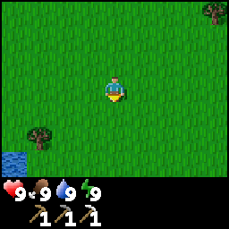
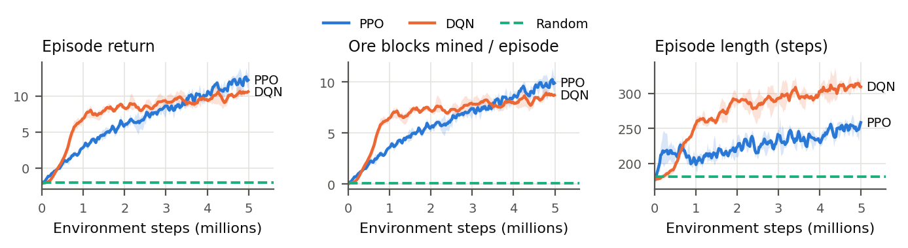
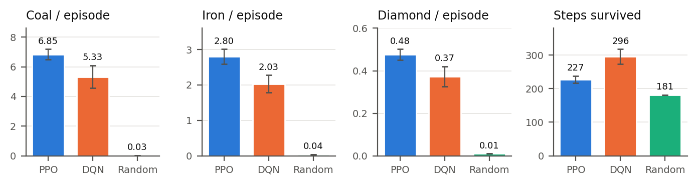
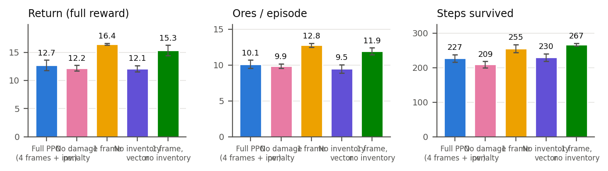

# Autonomous Mining with Reinforcement Learning

**AI Course, Assignment 2: Real-Life Use Cases of RL**

Autonomous mining robots have to find and extract ore using only what their cameras show them, while staying out of hazards. We model this task in **Crafter** ([Hafner, ICLR 2022](https://arxiv.org/abs/2109.06780)), a procedurally generated 2-D open world modelled on Minecraft. A **PPO** agent, written from scratch in PyTorch, sees stacked 64×64 RGB frames plus its inventory and health readings. It picks discrete move/turn/mine actions. It earns reward for mining coal, iron and diamond, and is penalised for every step taken and for any damage. We compare it against a **random** policy and a **DQN** agent, and run two ablations.

<p align="center"></p>

## Why Crafter instead of MineRL / full Minecraft?

The proposal targets Minecraft. MineRL needs Java 8 and a Malmo build, and runs at only about 60 steps/s. Learning to mine ore from pixels in it takes tens of millions of steps, which is more compute than a course project has. Crafter keeps every part of the formulation: egocentric pixels, an inventory, health and damage, stone, coal, iron and diamond deposits, lava, zombies and skeletons, and procedurally generated worlds. It runs at about 1,000 steps/s per CPU core and installs with pip. The environment code under `crafter` is untouched. **Everything specific to this task was written for this project:** the mining task, reward, vector env, networks, PPO, DQN, evaluation and plots.

## RL formulation

| | |
|---|---|
| **State S** | `image`: last 4 RGB frames, 64×64 each → uint8 tensor 12×64×64. It shows a 9×7-tile egocentric view of the world plus an inventory strip. `inv`: 16 inventory/vital counters (health, stone, coal, iron, diamond, pickaxes, …), scaled to [0, 1]. |
| **Action A** | Discrete(6): `noop`, `move_left`, `move_right`, `move_up`, `move_down`, `do` (mine/attack the tile it faces). A move also turns the robot to face that direction. |
| **Reward R** | r_t = 1·Δcoal + 2·Δiron + 5·Δdiamond + 0.02·Δstone − 0.001 − 0.1·(health lost) − 1·[destroyed] |
| **Episode** | Ends when the robot is destroyed (lava, mobs) or after 1000 steps. Hitting the time limit counts as truncation: the value is bootstrapped, not set to zero. |
| **Task setup** | The robot spawns with wood, stone and iron pickaxes. Hunger, thirst and fatigue are switched off, because a robot doesn't eat. Worlds are new every episode; evaluation uses held-out world seeds. |

## Repository layout

```
mining_rl/
  env.py        mining task wrapper (state, actions, reward) + subprocess VecEnv
  networks.py   CNN + inventory-MLP encoder, actor-critic and Q-network heads
  ppo.py        PPO (clipped surrogate, GAE, value bootstrapping on time-limit)
  dqn.py        Double-DQN with on-GPU replay buffer and target network
  evaluate.py   evaluation on held-out worlds (PPO / DQN / random)
  plot.py       report figures
  record.py     GIF of an agent
  common.py     seeding, CSV logging, checkpoints
scripts/run_all.sh   reproduces every result in the report
checkpoints/    final trained agents (*.pt)
results/runs/   training curves (progress.csv + config.json per run)
results/eval/   evaluation results (json, per-episode)
report/         LaTeX source of the 2-page report + figures
```

## Installation

Tested with Python 3.10, PyTorch 2.4 (CUDA 12.1) and Ubuntu 22.04.

```bash
conda create -n rlmine python=3.10 -y
conda activate rlmine
pip install torch==2.4.0 --index-url https://download.pytorch.org/whl/cu121   # or the CPU build
pip install -r requirements.txt
```

`numba` matters for speed: it makes Crafter's world generation about 17× faster.

## Usage

All commands run from the repository root.

**Watch / evaluate the trained agent (no training needed):**
```bash
python -m mining_rl.evaluate --checkpoint checkpoints/ppo_s1.pt --episodes 100
python -m mining_rl.evaluate --agent random --episodes 100
python -m mining_rl.record   --checkpoint checkpoints/ppo_s1.pt --out results/media/ppo_agent.gif
```

**Train:**
```bash
python -m mining_rl.ppo --seed 1 --total-steps 5000000          # ~1.2-1.6 h with 16 envs + GPU
python -m mining_rl.dqn --seed 1 --total-steps 5000000          # ~2.5 h
# ablations
python -m mining_rl.ppo --seed 1 --no-damage-penalty --run-name ppo_nodmg_s1
python -m mining_rl.ppo --seed 1 --frame-stack 1 --no-inventory --run-name ppo_pixels_s1
```
Useful flags: `--num-envs` (parallel worlds, default 16), `--device cpu`, `--survival` (switch hunger/thirst back on), `--no-tools` (spawn without pickaxes). Run `python -m mining_rl.ppo -h` for the full list.

**Reproduce everything (training → evaluation → figures):**
```bash
bash scripts/run_all.sh
```

**Rebuild figures from the logged results:** `python -m mining_rl.plot` (writes to `report/figures/`).

## Results

Evaluated on 100 episodes in **held-out worlds** for each seed (mean ± std over seeds). Every agent is scored with the same full reward.

| Agent | Return | Coal | Iron | Diamond | Ores / 100 steps | Steps survived |
|---|---|---|---|---|---|---|
| **PPO** (main, 3 seeds) | **12.7 ± 0.9** | **6.85** | **2.80** | **0.48** | **4.46** | 227 |
| DQN (3 seeds) | 9.1 ± 1.5 | 5.33 | 2.03 | 0.37 | 2.62 | 296 |
| Random | −2.05 | 0.03 | 0.04 | 0.01 | 0.04 | 181 |




**Ablations** (PPO, 2 seeds each):

| Variant | Frames | Inventory vector | Damage penalty | Return | Ores | Steps |
|---|---|---|---|---|---|---|
| Full PPO (main) | 4 | ✓ | ✓ | 12.7 ± 0.9 | 10.1 | 227 |
| No damage penalty | 4 | ✓ | – | 12.2 ± 0.5 | 9.9 | 209 |
| No inventory vector | 4 | – | ✓ | 12.1 ± 0.5 | 9.5 | 230 |
| **Single frame** | 1 | ✓ | ✓ | **16.5 ± 0.2** | **12.8** | 255 |
| Single frame, no inventory | 1 | – | ✓ | 15.3 ± 0.9 | 11.9 | 267 |



**Takeaways**
- Both RL agents learn to leave the grassland, find ore deposits and tunnel through them. The random policy mines almost nothing.
- DQN learns faster at first (return 5 after ~0.75M steps vs ~1.5M for PPO), but PPO overtakes it after ~3.5M steps. PPO ends with 31% more ore, mostly from the rarer iron and diamond.
- DQN survives longer but mines slowly. PPO mines faster and takes more risk (16% of its deaths are from lava, vs 5% for DQN).
- The damage penalty modestly improves survival (+8% episode length).
- Frame stacking *hurts* at this 5M-step budget: a single frame plus the inventory vector is the best agent (`checkpoints/ppo_fs1_s*.pt`). The inventory vector gives a small, consistent gain.
- Main failure mode: nearly every episode ends in death, soon after the first nightfall (~step 200), when zombies and skeletons appear. The agent has no sword or shelter actions.

## Algorithms and hyper-parameters

| | PPO | DQN |
|---|---|---|
| Network | 3-layer CNN (32-64-64) ⊕ inventory MLP (64) → 512 | same encoder |
| Parallel envs | 16 | 16 |
| Rollout / replay | 256 steps × 16 envs = 4096 | 100k transitions (on GPU) |
| Optimiser | Adam 3e-4, linearly annealed | Adam 1e-4 |
| Discount γ | 0.99 (GAE λ = 0.95) | 0.99 |
| Other | clip 0.2, 4 epochs × 8 minibatches, entropy 0.01, value 0.5, grad-norm 0.5 | Double-DQN, Huber loss, batch 64, 1 update / 8 env steps, target sync 10k steps, ε 1→0.05 over 10% |
| Budget | 5M env steps × 3 seeds (ablations: 2 seeds) | 5M env steps × 3 seeds |

## Report

The 2-page report source is in `report/` (`report.tex`, two-column IEEE format). To build it, upload the folder to Overleaf, or run `pdflatex report.tex` there.
